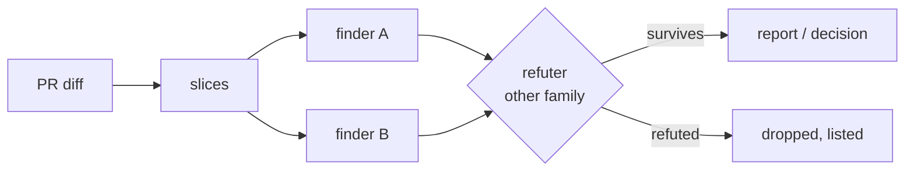

# review-skills

Claude Code skills for reviewing GitHub PRs with more than one model family. Finders look for defects. A refuter from a different model family then tries to disprove each one against the PR-head source. Only findings that survive the refuter are reported.

| Skill | Say | What you get |
|---|---|---|
| `pr-review` | `/pr-review 123` | A report of the findings that survived, plus a plain-language brief of the PR for you |
| `intense-review` | `/intense-review 123` | The same with two finders at top effort, a third-family refuter under an evidence burden, and no dollar cap |
| `peer-review` | `/peer-review 123` | A decision: **approve**, **request changes**, or a **fix PR** stacked on the author's. It posts only after you check it |
| `delegate` | `/delegate` | An approved plan implemented by antigravity (agy) in a throwaway worktree, returned as a patch |
| `ollama-agents` | `/ollama-agents` | The same as `delegate`, routed to ollama.com models. Adds `--map` for one extraction run over many files |



## Install

```bash
git clone https://github.com/srieteja/claude-review-skills ~/src/review-skills
~/src/review-skills/bin/review-skills install   # links skills into ~/.claude/skills, seeds the config
~/src/review-skills/bin/review-skills doctor    # what is missing, and which models will run
```

- **Needs:** bash 3.2+, git, `gh` (signed in), jq, curl, python3, awk.
- **Recommended:** `timeout`, or `gtimeout` on macOS (`brew install coreutils`). An anthropic or ollama refuter can't run without it.
- **Updating:** run `git pull`. The skills are symlinks, so there is nothing to reinstall.
- **Installing elsewhere:** set `CLAUDE_SKILLS_DIR` to put the links somewhere other than `~/.claude/skills`.
- **Conflicts:** `install` never overwrites anything. If something is already in the way, it names it and exits non-zero.

## Backends: any one is enough

| Backend | How to enable | Model family |
|---|---|---|
| anthropic | `claude auth login` (subscription), or `ANTHROPIC_USE_API_KEY=1` + `ANTHROPIC_API_KEY` | Claude |
| agy | sign in to antigravity; it takes no key | Gemini |
| ollama | `OLLAMA_API_KEY` | glm, kimi, … |

- **Keys:** put them in `~/.config/review-skills/config.env`. Override the path with `REVIEW_SKILLS_CONFIG`.
- **Precedence:** a variable set in the environment beats the file.
- **File permissions:** keep the file at mode 600. `doctor` fails if others can read it.
- **Allowlist:** only known keys are read from the file. Everything else in it is ignored.
- **Template:** [`config.example.env`](config.example.env) lists every key.

## Models: auto or pinned

`REVIEW_SKILLS_MODELS=auto` is the default. It works like this:

1. **Probe.** It finds which backends answer on this machine. Model lists are cached for a day.
2. **Pick.** It takes the best reachable rows from [`lib/models.tsv`](lib/models.tsv): one finder for a regular review, one per transport for intense.
3. **Refuter.** It prefers a refuter outside every finder's family. It drops a second finder if keeping it would leave no such refuter.
4. **Report.** `review-skills models` prints the result and flags a same-family refuter as weaker refutation.

To choose models yourself:

- **`manual`:** skips the probes and takes the first rows.
- **Pins:** set `PR_REVIEW_FINDERS`, `PR_REVIEW_REFUTER`, `PR_REVIEW_INTENSE_FINDERS` or `PR_REVIEW_INTENSE_REFUTER`. A pin is used as written.

```text
$ review-skills models
  regular  anthropic:claude-opus-5-5@xhigh -> refuted by agy:gemini-3.8-flash-high
  intense  anthropic:claude-opus-5-5@max agy:gemini-3.8-flash-high -> refuted by ollama:glm-5.3-flash
```

## Cost and data

| | Regular | Intense |
|---|---|---|
| Anthropic cap | `PR_REVIEW_BUDGET_USD` per slice, $8 by default; measured slices cost about $3 | **none**: the per-slice timeout is the only ceiling |
| Brief | `PR_REVIEW_BRIEF_BUDGET_USD`, $1 by default | same |
| Biggest lever | `PR_REVIEW_CHUNK_BYTES`: fewer, larger slices | same |

- **Subscriptions.** With `claude` signed in to a subscription, runs use your session limit, not dollars. When the limit is hit, stage 1 stops at once. Finished slices are cached, so a rerun resumes where it stopped.
- **Data egress to ollama.com.** When ollama is in the mix, the diff, the claims and every source file the model opens are sent to ollama.com. Leave `OLLAMA_API_KEY` unset for code that must not leave the vendors you already use.
- **Local store.** Reviews are kept under `PR_REVIEW_DIR`, `~/.reviews` by default:
  - regular: `<store>/<author>/<repo>/<N>/`
  - intense: `<store>/_intense/<author>/<repo>/<N>/`

## peer-review decisions

- **Two steps.**
  - `prepare` reviews the PR, decides, and freezes the exact text it will post.
  - `--ship` posts that frozen text, pinned to the reviewed commit. Nothing reaches GitHub before you check it.
- **Approve gate.** Approval requires all of these:
  - zero CONFIRMED findings;
  - every finding checked;
  - every slice reviewed;
  - output from the anthropic finder.

  A run in which the anthropic finder produced nothing can request changes, but it cannot approve.
- **Fix PRs.** Fix PRs are opened only for authors listed in `PR_REVIEW_FIX_AUTHORS`, which is empty by default. For everyone else, confirmed findings become a request for changes.
- **Engine.** peer-review runs `intense-review` when a third-family refuter is reachable, and the regular `pr-review` otherwise.

## Repo knobs

The defaults suit Dart repos. For other languages, set these in `config.env`:

| Knob | Default | Decides |
|---|---|---|
| `PR_REVIEW_TEST_RE` | `(^\|/)tests?/\|_test\.dart$` | which diff files are tests, reviewed in their own pass |
| `PR_REVIEW_CROSS_RE` | `(pubspec\.yaml\|/lib/[^/]+\.dart)$` | which files earn a cross-cutting pass |

Each skill's `SKILL.md` lists its own knobs. Each `DESIGN.md` explains why the pipeline is built the way it is.

## CLI

| Command | Does |
|---|---|
| `review-skills install` | links the skills; creates `config.env` from the template if there is none |
| `review-skills doctor` | checks tools, `gh` login, config permissions, which keys are set (never their values), backends, and resolved models |
| `review-skills models [regular\|intense] [--refresh]` | shows the models a review would run; `--refresh` asks every backend again |
| `review-skills test [--list]` | runs every offline suite, with stubbed models: nothing is spent and GitHub is never touched |

## Development

- **Tests.** `bin/review-skills test` runs the offline suites on macOS and Linux. CI runs them plus `shellcheck -S error`.
- **Selftests.** `selftest.sh` and `bakeoff.sh` call real models and cost money. Neither is part of `test`.
- **Portability.** Scripts target bash 3.2 (the macOS system bash), BSD and GNU userlands, and mawk.

## License

BSD 3-Clause. See [LICENSE](LICENSE).
