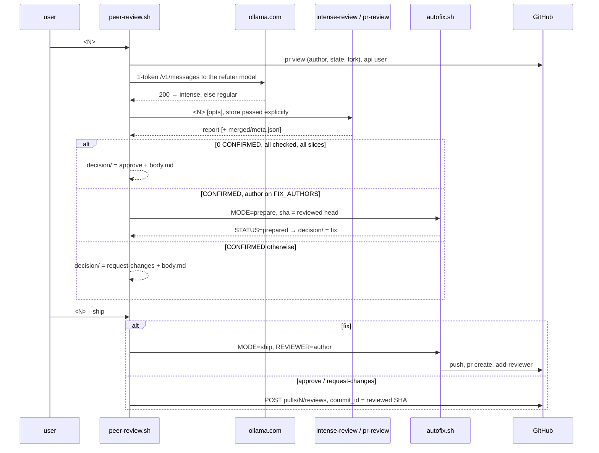

# peer-review — design

## Shape

## Decisions

| decision | why | rejected |
|---|---|---|
| Three decisions, and only three; nothing else is frozen | The user asked for exactly approve, fix (only for chosen authors) or request-changes. Every other outcome — an unchecked finding, a skipped slice, a failed review — is exit 1 with nothing to ship, so `--ship` can never post something no one decided. | A fourth "comment" decision for UNVERIFIABLE findings: not one of the three asked for. |
| Probe ollama with a 1-token call to the refuter model, 10s, only HTTP 200 counts | The refuter is the one stage of intense-review that dies mid-run when ollama can't serve, after the finders were paid for. A `/api/tags` reachability check passes with a bad key or an unserved model. The key goes to curl on stdin (`-K -`), never argv. | Running intense and falling back on failure: pays for the finders twice. |
| Regular review runs with `PR_REVIEW_FINDERS`/`PR_REVIEW_REFUTER` unset | A refuter of `ollama:…` left in the environment would put back the dependency the probe just ruled out. | — |
| Fail closed on approve | An approval vouches for code. With a record, the SHA comes from `meta.json` and `**Incomplete.**` blocks it; without one, the report must name its 40-hex head and say `**No findings.**` (the anthropic finder ran), and `Slices that produced nothing` blocks it. A verdict outside CONFIRMED/REFUTED/UNVERIFIABLE is unchecked and blocks every decision. | Trusting rc 0: `pr-review.sh` exits 0 having reviewed nothing. |
| UNVERIFIABLE-only findings still approve | They were checked and couldn't be confirmed; the plan was approved on that basis. The report lists them for the human to weigh before ship. | Request changes on them: asks the author to fix what no one could show is broken. |
| A fix author's fix that autofix refuses falls back to request-changes; `stale`/`exists:` don't | A refused patch (ungated file, red tests) still leaves CONFIRMED findings the author should hear about. A moved head or an existing fix PR means this run's decision is already wrong or already made. | — |
| Post approve/request-changes with `gh api … reviews -f commit_id=SHA`, once, guarded by `posted` | `gh pr review` has no `commit_id`, so an approval would land on whatever the head is by then. The marker makes a re-run of ship report `exists:` rather than post twice. | `gh pr review --approve`. |
| Prepare clears `decision/` and `autofix/` in both stores and sets the old report aside | The engine can change between runs, so an earlier decision in the other store would still be shippable. With no `meta.json`, an older clean report would be read as this run's. | Clearing only the chosen store: mutation-checked, it lets a stale approve ship. |
| `decision` file written last | Ship reads a decision only once `sha` and `body.md` are in place, so an interrupted prepare can't ship an empty review. | — |
| Shared `confirmed.jq` for the findings text | autofix's fix-PR body and the change-request body list CONFIRMED findings with the same `@`-quieting. One definition means one place to fix a mention leak. | — |
| Extend `autofix.sh` with `AUTOFIX_MODE`, don't fork it | One pipeline, one set of guards, one test suite. An unattended caller runs the unset mode, so the ship-readiness fixes below reach it too. | Copying it into peer-review means two copies of the gate to keep in sync. |
| Two calls with frozen artifacts | Whatever the human approved is exactly what gets pushed. Ship re-applies the frozen patch rather than re-running agy, and an LLM rerun is not reproducible. | One call with an interactive prompt: it can't run in the background, and the patch would still be in a temp dir. |
| Pin the SHA from `meta.json` and refuse `stale`, in every mode | The findings and the patch describe one tree. If the author pushes mid-review, the fix PR would quietly revert or conflict with their new commits; after a rebase, it would carry the commits they dropped. The cron path skipped this check on the theory that a fix on an ancestor merges cleanly, which a rebase breaks. | Rebasing the patch onto the new head turns that into silent merge decisions. Checking only `merge-base --is-ancestor`: a second rule for the cron, when its next tick re-reviews the new head anyway. |
| Clear `merged.json`/`meta.json` before the review | `pr-review.sh` exits 0 on zero findings without writing them, so a previous review's record would be fixed as if it were this one's. | mtime comparison is unreliable at one-second resolution, and that's exactly what the tests hit. |
| Preflight in the wrapper as well as the fork guard in autofix | Refuse bot, closed and fork PRs before paying for an uncapped review. The autofix guard stays for the cron path. | — |
| stdout `STATUS=`/`REVIEWER=` protocol; rc 0 = done or nothing to do, 1 = refused or failed | Claude and scripts parse one line. An unattended caller can key off rc alone. | JSON on stdout: heavier than two keys need. |
| A failed review request still exits 0 | The PR is already public by then. A non-zero exit would read as "nothing happened". | — |
| autofix acts only on a record whose `meta.json` `headRefOid` is the `<sha>` it was given | The wrapper clears the record before a review, but an unattended caller may not. A zero-finding review left the previous review's findings to be re-filed against the new head. | Clearing in every caller too: two places owning one invariant. |
| Ship reads only the frozen files; the commit message is the title plus fixed text | Everything public is something the human read. The old message listed each claim from `merged.json`, which is unedited LLM text. | Freezing a commit message too: one more file to review, for text nobody reads. |
| Commit on a detached HEAD, push `HEAD:refs/heads/<branch>`, never force | A worktree shares refs with the clone. `checkout -b` left a `fix/…` branch there, and that made every retry fail. | `--force-with-lease`: it would overwrite a branch someone else pushed. |
| Resume an orphan fix branch only if it is one commit on `<sha>` with this tree; look for it at the push URL | A failed `pr create` leaves the branch pushed. A retry should finish the job; anything else on that branch is not ours to replace. Fetching by remote name reads the fetch URL, which may be a mirror without the branch. | Comparing commit SHAs: the author date differs on every run. |
| `git apply --index`, gate and commit the index only | Without it, new files were untracked, so the gate never saw them. `add -A` also committed `pubspec.lock` and other `pub get` debris. | — |
| Refuse files outside every package, and anything under `.github/`; list paths with `--no-renames` | An ungated file was shipped whenever it sorted before a gated one. A workflow change runs with the repo's secrets, and no `dart test` vouches for it; at_client_sdk's root `pubspec.yaml` would otherwise "cover" it. With rename detection on, a move listed only its destination, so the package it left went ungated and a workflow could be moved out of `.github/`. | Gating non-Dart files some other way: there is no test to run. |
| Word joiner after a word-initial `@` in finding text, `_` included | Findings quote code, so a decorator like `@override` would ping whoever owns that login, and a quoted handle would ping its owner. `_@x_` is emphasis around a live mention; GitHub's renderer linked it until `_` counted as a boundary. | Backticking the claim: it loses the bold lead and still leaves the mechanism. |
| Closing keywords are not rewritten | GitHub ignores them on a PR whose base isn't the default branch, which a fix PR's base never is. They're on the pre-ship checklist instead. | — |
| `push` URL, PR `state`, and `dart` on `PATH` checked before the implementer | Each one otherwise failed after the implementer was paid for, or pushed somewhere the PR can't see. | — |
| The wrapper drops `autofix/` before a review, whatever the review ends in | A re-run whose review found nothing, or failed, left the previous prepare for `--ship` to post. | — |
| Push with `--no-follow-tags`; gate tests with stdin on `/dev/null`; refuse a blank frozen title | Each closes a fail-open path that nothing triggers today: a `push.followTags` config would publish local tags, a test reading stdin would eat the gate's package list, and a blank title would push a branch `pr create` can't open. | — |

## Out of scope (flagged)

- **`pr-review.sh` writes no record at zero findings**, so the wrapper parses the report for the head SHA and completeness. A `meta.json` written always would retire that parsing and the string-pinning test.

- **The test gate is Dart-only.** Non-Dart patches are refused, not gated.
- **Prepare runs untrusted code locally.** `claude -p` runs unattended with accept-edits and `dart test` as a tool, so model-written code runs before the gate does, and the gate's `dart test` executes the patch and the PR's own tests, all before a human reads anything. Sandboxing both is its own project.
- **A same-repo push runs CI with the repo's secrets.** The `.github/` refusal stops the patch from changing workflows, but not from changing what an existing workflow runs.
- **`gh pr list --head` matches by branch name across forks.** A fork with a `fix/prN-review-findings-<sha12>` branch for the same head reads as `exists`. That fails safe: nothing is opened.

## Tests

- **`offline-test.sh`** (this dir) tests the wrapper against stubbed `gh`, `curl`, both engines and autofix: the probe and engine choice, each decision, every fail-closed refusal, ship's pinning, staleness and once-only posting, and a grep pinning the report strings it parses against `pr-review.sh` and `report.jq`.
- **`pr-review/autofix-test.sh`** runs the real autofix against a throwaway repo with a bare origin, with `gh`, `claude` and `dart` stubbed. It covers every guard, the gate's file rules, the resume and the refusal, and @-mentions.
- **`e2e-test.sh`** (this dir) runs the real wrapper over the real autofix, prepare through ship, including a ship cut short after the push and then re-run.
- **The resume tests re-run with a pinned commit date.** Two runs in one second build byte-identical commits, so a "resumed" push was a no-op that passed without the resume. Every fix in the last two rounds was mutation-checked: revert it, and its tests go red.
- **The three-decision redesign was mutation-checked**: 23 mutants of `peer-review.sh` (probe, verdict whitelist, each fail-closed check, store clearing, pinning, posted marker), all killed.
- None of them cost anything or touch GitHub.
