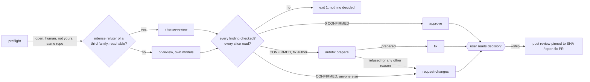

# Peer review

A review, then one decision, frozen for a human to read before anything goes public. Read
`~/.claude/skills/intense-review/SKILL.md` and `~/.claude/skills/pr-review/SKILL.md` for the engines,
and the "Auto-fix PRs" section of the latter for the fix pipeline. This file covers only what
the wrapper adds.



## Run it

```bash
~/.claude/skills/peer-review/peer-review.sh <PR-NUMBER> [--no-cache|--keep|--findings f|--jobs n]
```

- **Launch in the background.** In Claude Code use `run_in_background: true`. An intense review runs slices of up to 60m per finder.
- **Run from inside the PR's repository**, outside the Claude Code sandbox (`gh` reads its token from the keychain), with `dart` on `PATH`. A fix needs `origin`, including any push URL, to be the PR's repo.
- **Env:**

| var | effect |
|---|---|
| `OLLAMA_API_KEY` | absent, with the intense refuter on ollama: no probe, the regular review runs |
| `PR_REVIEW_FIX_AUTHORS` (alias `PEER_REVIEW_FIX_AUTHORS`) | who gets a fix PR instead of a change request. Default none; space- or comma-separated, case-insensitive; empty for none. The engine runs with `--no-fix`: the fix PR opens only on `--ship` |
| `AUTOFIX_LINT=1` | adds the lint lane: `LANE=lint`, frozen in `autofix/lint/`, a fix PR clearing `dart analyze` issues on the PR's base in the packages it touches (`AUTOFIX_LINT_LEVEL`, see pr-review). Off by default |
| `PR_REVIEW_INTENSE_REFUTER` | the intense refuter (default: resolved, as `/intense-review` does). On ollama it is probed; of a finder's own family, the regular review runs |
| `PR_REVIEW_INTENSE_DIR`, `PR_REVIEW_DIR` | the two stores (default `~/.reviews/_intense`, `~/.reviews`) |

- **Refused before any spend:** a bot author, your own PR, a PR closed unmerged, `--post`/`--inline`/`--yes` (ship posts), `--sha` (the decision is about the live head).

## Before you run it, tell the user

- **The engine is picked before any spend**, printed as `ENGINE=intense|regular`: intense when its resolved refuter is of a family no finder is from and, on ollama, answers a 1-token call. On intense, intense-review's warning applies: cost is uncapped, and the diff and claims may go to ollama.com. The regular review resolves its own models; `PR_REVIEW_FINDERS` / `PR_REVIEW_REFUTER` pins are not passed to it.
- **For a fix author, a CONFIRMED finding means `claude -p` writes code** from LLM findings about someone else's PR, and prepare runs it (accept-edits, with `dart test`/`pub get`/`analyze` as its only shell, in a throwaway clone, then `dart pub get && dart test`, or `dart analyze` for a live-rig pack under `tests/`) before anyone reads it. `AUTOFIX_MODEL` picks the model (default `claude-opus-5-5`), and prepare prints it as `IMPLEMENTER=`. The gate is Dart-only: a patch touching `.github/` or a file outside every package is refused, and the decision falls back to request-changes.

## What prepare ends in

| stdout | meaning |
|---|---|
| `STATUS=prepared` + `DECISION=approve` | nothing CONFIRMED, every finding checked, every slice reviewed. UNVERIFIABLE findings don't block it — say so when relaying. |
| `STATUS=prepared` + `DECISION=fix` | a frozen fix in `autofix/`; on a merged PR, the trunk lane's in `autofix/trunk/` |
| `STATUS=prepared` + `DECISION=request-changes` | CONFIRMED findings, frozen into `decision/body.md` |
| `STATUS=stale` / `STATUS=exists:<url>` | from autofix: the head moved, or a fix PR for this head already exists (one for an earlier head doesn't count). Nothing decided. |
| `LANE=<lane> STATUS=…` | one line per fix lane beside the decision: `stacked` (the fix above), `trunk` (confirmed findings already on the PR's base, frozen in `autofix/trunk/`, a fix PR against trunk), `lint` (with `AUTOFIX_LINT=1`). A side lane that fails or drops is reported, never the decision's outcome. |
| `STATUS=merged-clean` | the PR merged with nothing confirmed, or the trunk lane found nothing left on its base. Nothing decided. (A trunk fix PR already open: `STATUS=exists:<url>`.) |
| exit 1 | refused, failed, a finding left unchecked (`ERROR` or no verdict), or a clean review that skipped slices. Nothing decided — re-run. |

- **Lanes:** only findings the PR introduced decide approve/fix/request-changes; pre-existing ones (`route: pre-existing`) go to the trunk lane, whoever the author. A merged PR has only the trunk lane, decided `fix`. A fork PR gets request-changes instead of a stacked fix.

Re-running prepare discards any earlier decision and fix in both stores, whatever the new run ends in.

## Between prepare and ship (don't skip this)

Show the user, from `<store>/<author>/<N>/` (the store `ENGINE=` named):

| decision | files |
|---|---|
| any | `pr<N>-review.md`: the findings |
| approve, request-changes | `decision/body.md`: the exact review text. Offer to edit it. |
| any, with a trunk lane | `autofix/trunk/{fix.patch,title,body.md}` |
| fix | `autofix/fix.patch` (read it for anything beyond the findings: network calls, CI or config edits, deleted tests), `autofix/title`, `autofix/body.md` |

Check the public text: an `@` that starts a word in finding text already carries a word joiner, so it pings no one, but any `@` you add will. Each `#N` cross-references; don't add closing keywords.

**Ship only on an explicit yes.** It posts a public review or opens a public PR and pings the author.

```bash
~/.claude/skills/peer-review/peer-review.sh <PR-NUMBER> --ship
```

- **approve / request-changes** post one review via `gh api …/pulls/<N>/reviews` with `commit_id` pinned to the reviewed SHA, then write `decision/posted`.
  - `STATUS=approved:<url>` / `STATUS=changes-requested:<url>`: give the link.
  - `STATUS=exists:<url>`: already posted; nothing sent.
  - `STATUS=stale`, exit 1: the author pushed since the review. Re-run prepare.
  - A blank `body.md` on request-changes is refused.
- **fix** runs autofix's ship (see pr-review's SKILL.md) per lane, stacked then trunk: `LANE=<lane> STATUS=opened:<url>`, then `REVIEWER=requested|skipped|failed:<login>`. `failed` usually means the author lacks repo access — say so, don't retry.
- **A decision in both stores** is refused ("both"). Re-run prepare.
- **Each lane ships on its own:** the stacked lane asks the PR's author; trunk asks no one unless autofix's blame finds a reviewer. A lane that fails exits 1 and the rest still go; a re-ship sends only what didn't.
- **`decision/posted`** holds the review or stacked fix-PR URL; `decision/posted.<lane>` each other lane's. A second ship prints `STATUS=exists:<url>` (`LANE=<lane> STATUS=exists:<url>` for a lane).
- **A review frozen while open, merged since:** `STATUS=merged`, exit 1, nothing posted. Re-run prepare.

## Overriding the decision (`--decide`)

```bash
~/.claude/skills/peer-review/peer-review.sh <PR-NUMBER> --decide approve|request-changes|fix [--body-file f]
```

This re-freezes a different decision from the review already on disk. It never re-reviews and never posts. Ship it afterwards as usual.

| case | behavior |
|---|---|
| `fix` | runs autofix prepare **regardless of `PR_REVIEW_FIX_AUTHORS`**: a human chose this. It needs at least one CONFIRMED finding in its lane (stacked while open, trunk once merged); a fork PR has no stacked lane. After a `LANE=stacked STATUS=retarget`, when no other lane has gone out, `--decide fix` re-freezes it on trunk and drops the stacked lane; once one has, it's refused and the stacked findings need a follow-up by hand. If autofix refuses, the earlier decision stands (exit 1). |
| `request-changes` | the body comes from the CONFIRMED findings, or from `--body-file`. With neither, it is refused. |
| `approve` | the stacked fix is dropped; trunk and lint lanes stay, independent of the decision |
| refused | anything but `fix` on a merged PR, after ship (`posted` exists), when the PR is already decided that way with no new body, `--body-file` with `fix`, or alongside `--ship` or review options |

While prepare or `--decide` runs, `<store>/<author>/<repo>/<N>/running` holds its pid. A dashboard reads it to tell a live run from a crashed one.
