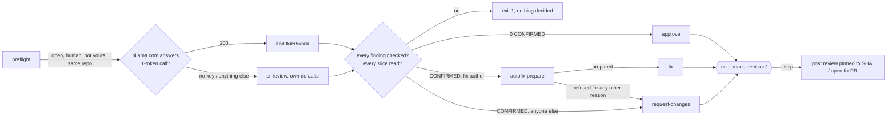

# Peer review

A review, then one decision, frozen for a human to read before anything goes public. Read
`~/work/skills/intense-review/SKILL.md` and `~/work/skills/pr-review/SKILL.md` for the engines,
and the "Auto-fix PRs" section of the latter for the fix pipeline. This file covers only what
the wrapper adds.



## Run it

```bash
source ~/.env.local && ~/work/skills/peer-review/peer-review.sh <PR-NUMBER> [--no-cache|--keep|--findings f|--jobs n]
```

- **Launch in the background.** In Claude Code use `run_in_background: true`; in Hermes use `terminal(background=true, notify_on_complete=true)`. An intense review runs slices of up to 60m per finder.
- **Run from inside the PR's repository**, outside the Claude Code sandbox (`gh` reads its token from the keychain), with `dart` on `PATH`. A fix needs `origin`, including any push URL, to be the PR's repo.
- **Env:**

| var | effect |
|---|---|
| `OLLAMA_API_KEY` | absent: no probe, the regular review runs |
| `PR_REVIEW_FIX_AUTHORS` (alias `PEER_REVIEW_FIX_AUTHORS`) | who gets a fix PR instead of a change request. Default `gkc`; space- or comma-separated, case-insensitive; empty for none. The engine runs with `--no-fix`: the fix PR opens only on `--ship` |
| `PR_REVIEW_INTENSE_REFUTER` | the model probed (default `ollama:glm-5.3-flash`) |
| `PR_REVIEW_INTENSE_DIR`, `PR_REVIEW_DIR` | the two stores (default `~/work/reviews-intense`, `~/work/reviews`) |

- **Refused before any spend:** a bot author, your own PR, a PR that isn't open, a fork PR, `--post`/`--inline`/`--yes` (ship posts), `--sha` (the decision is about the live head).

## Before you run it, tell the user

- **The engine is picked by a 1-token probe**, printed as `ENGINE=intense|regular`. On intense, intense-review's warning applies: cost is uncapped, and the diff and claims go to ollama.com. The regular review runs with no ollama anywhere, even if `PR_REVIEW_REFUTER` says otherwise.
- **For a fix author, a CONFIRMED finding means `claude -p` writes code** from LLM findings about someone else's PR, and prepare runs it (accept-edits, with `dart test`/`pub get`/`analyze` as its only shell, in a throwaway clone, then `dart pub get && dart test`) before anyone reads it. `AUTOFIX_MODEL` picks the model (default `claude-opus-5-5`), and prepare prints it as `IMPLEMENTER=`. The gate is Dart-only: a patch touching `.github/` or a file outside every package is refused, and the decision falls back to request-changes.

## What prepare ends in

| stdout | meaning |
|---|---|
| `STATUS=prepared` + `DECISION=approve` | nothing CONFIRMED, every finding checked, every slice reviewed. UNVERIFIABLE findings don't block it — say so when relaying. |
| `STATUS=prepared` + `DECISION=fix` | a frozen fix in `autofix/` |
| `STATUS=prepared` + `DECISION=request-changes` | CONFIRMED findings, frozen into `decision/body.md` |
| `STATUS=stale` / `STATUS=exists:<url>` | from autofix: the head moved, or a fix PR already exists. Nothing decided. |
| exit 1 | refused, failed, a finding left unchecked (`ERROR` or no verdict), or a clean review that skipped slices. Nothing decided — re-run. |

Re-running prepare discards any earlier decision and fix in both stores, whatever the new run ends in.

## Between prepare and ship (don't skip this)

Show the user, from `<store>/<author>/<N>/` (the store `ENGINE=` named):

| decision | files |
|---|---|
| any | `pr<N>-review.md`: the findings |
| approve, request-changes | `decision/body.md`: the exact review text. Offer to edit it. |
| fix | `autofix/fix.patch` (read it for anything beyond the findings: network calls, CI or config edits, deleted tests), `autofix/title`, `autofix/body.md` |

Check the public text: an `@` that starts a word in finding text already carries a word joiner, so it pings no one, but any `@` you add will. Each `#N` cross-references; don't add closing keywords.

**Ship only on an explicit yes.** It posts a public review or opens a public PR and pings the author.

```bash
source ~/.env.local && ~/work/skills/peer-review/peer-review.sh <PR-NUMBER> --ship
```

- **approve / request-changes** post one review via `gh api …/pulls/<N>/reviews` with `commit_id` pinned to the reviewed SHA, then write `decision/posted`.
  - `STATUS=approved:<url>` / `STATUS=changes-requested:<url>`: give the link.
  - `STATUS=exists:<url>`: already posted; nothing sent.
  - `STATUS=stale`, exit 1: the author pushed since the review. Re-run prepare.
  - A blank `body.md` on request-changes is refused.
- **fix** runs autofix's ship (see pr-review's SKILL.md): `STATUS=opened:<url>`, then `REVIEWER=requested|skipped|failed:<login>`. `failed` usually means the author lacks repo access — say so, don't retry.
- **A decision in both stores** is refused ("both"). Re-run prepare.
- **`decision/posted`** holds the review or fix-PR URL once anything has shipped. A second ship prints `STATUS=exists:<url>`.

## Overriding the decision (`--decide`)

```bash
source ~/.env.local && ~/work/skills/peer-review/peer-review.sh <PR-NUMBER> --decide approve|request-changes|fix [--body-file f]
```

This re-freezes a different decision from the review already on disk. It never re-reviews and never posts. Ship it afterwards as usual.

| case | behavior |
|---|---|
| `fix` | runs autofix prepare **regardless of `PR_REVIEW_FIX_AUTHORS`**: a human chose this. It needs at least one CONFIRMED finding. If autofix refuses, the earlier decision stands (exit 1). |
| `request-changes` | the body comes from the CONFIRMED findings, or from `--body-file`. With neither, it is refused. |
| `approve` | any frozen `autofix/` is dropped |
| refused | after ship (`posted` exists), when the PR is already decided that way with no new body, `--body-file` with `fix`, or alongside `--ship` or review options |

While prepare or `--decide` runs, `<store>/<author>/<N>/running` holds its pid. The `/reviews` dashboard reads it to tell a live run from a crashed one.

## Unattended (the watcher)

`~/work/skills/pr-review/watch.sh`, run every 10 min by Hermes, runs prepare on every PR that
asks `srieteja` for a review across `org:atsign-foundation`, in `~/work/<repo>`, and ships
with no human read in between — **except approvals**:

| decision | unattended |
|---|---|
| request-changes | shipped: `changes-requested` in the ledger |
| fix | shipped: `fix-opened` |
| approve | **held**: `approve-held`. The Hermes report carries the `--ship` command |

A wrong change request costs a comment and a wrong fix PR just goes unmerged; a wrong
approval can satisfy branch protection and merge a defect. That is why only approvals wait.
Record and queue: pr-review's SKILL.md, "The watcher, the queue, and the record".

