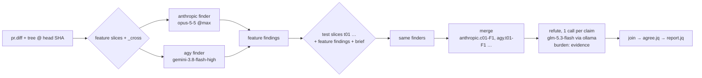

# Adversarial PR review pipeline

`~/.claude/skills/pr-review/pr-review.sh` — one or more finders review a PR (default: Opus 5.5), a
refuter tries to refute each finding against the PR-head source (default: Gemini 3.8 Flash), and
only what survives is reported. `~/.claude/skills/intense-review/` is a preset over it: two
finders, an ollama refuter, the evidence burden, no dollar cap.

## Why two models

A single reviewer's output has one failure mode you cannot see from the output: a
finding that is fluent, well-argued, cites a real file and line, and is wrong. It reads
exactly like a correct finding. `reviews/pr2179-bugs.md` was produced by hand precisely
because that risk needed a human to absorb it.

The second model is not a second opinion. It is a refuter with the burden of proof
inverted, given one claim at a time and told to default to REFUTED when it cannot verify.

## Stages

| Stage | Runner | Output |
|---|---|---|
| 0 | `gh` + `git clone --shared` at PR head SHA | `pr.diff`, `tree/` |
| 0.5 | `claude -p --model claude-sonnet-5-5 --effort medium`, no tools | `reviews/pr<N>-explainer.md` |
| 1 | each finder in `PR_REVIEW_FINDERS` (default `claude -p --model claude-opus-5-5 --effort xhigh`) × each slice | `findings.json` |
| 2 | `refute` with `PR_REVIEW_REFUTER` (default `agy --model gemini-3.8-flash-high`), one call per claim | `verdicts/<id>.json` |
| 3 | `jq` join on claim id → `agree.jq` (multi-finder) → `report.jq` | `reviews/pr<N>-review.md` |
| 4 | `gh pr comment` | posted, only after confirmation |

## Three decisions that carry the design

**Worktree at the PR head SHA, never the local working tree.** Line numbers in a finding
are only meaningful against the commit they were derived from. Validating
`assurance.dart:22` against a dirty feature branch produces refutations that are wrong
*and indistinguishable from correct ones* — the single most dangerous failure available
to this design, because it degrades silently and looks like it worked.

**Refute, don't validate.** "Are these findings correct?" returns near-total agreement.
The prompt inverts this: the burden is on the claim, plausibility is explicitly not
evidence, and inability to verify is a refutation rather than a gap.

**One validator call per claim.** A model handed a list of six findings reads it as
"a list of six real bugs" and grades on internal consistency. Isolation forces each
claim to be traced through source on its own.

## What is kept, and why

Three buckets, not a filter. REFUTED findings stay in the report inside a collapsed
section with the refuter's reason. A validator silently deleting a real bug is the one
failure this pipeline cannot detect on its own; keeping the refutations is what makes it
auditable by the person reading the report.

An `ERROR` verdict (validator produced nothing) is rendered as **"this claim was NOT
checked"** and bucketed with disputed, never with confirmed. A missing check is not a pass.

## Several finders, one refuter, a choice of burden

| Decision | Why |
|---|---|
| **One finder per transport**, tagged by transport (`anthropic.`, `agy.`) | The tag has to be stable, short and filesystem-safe: it prefixes slice keys, claim ids and cache dirs. The transport is all three. Two finders on one transport would need a model-derived tag, and nobody has asked for that yet, so it is refused up front instead of colliding in the cache. |
| **Per-finder cache dir**, keyed on SHA + that finder's prompt checksum + model/effort/transport | An agy slice must never be served as an anthropic one. The checksum covers the emit files and `findings.schema.json`, so a schema edit invalidates only the finder that uses it. |
| **Agreement is annotated, not deduplicated** (`.also`) | Deduplicating means picking one mechanism and discarding the other. Keeping both gets each one refuted independently. Two findings on the same spot, both surviving, is the strongest signal the report can carry. |
| **Coverage gaps are per finder** | If one finder's slice failed, those files were still read by the other finder, but not by both. The banner says which finder missed which slice. |
| **Burden is a directory** (`burden/strict`, `burden/evidence`) swapped into `refute.prompt` | Swapping text files keeps the gate honest: `strict` renders byte-identical to the pre-split prompt, so the default path is unperturbed. |
| **`evidence` for a flash refuter** | Under `strict`, "could not confirm" means REFUTED. A fast model gives up sooner, so real bugs get silently refuted. Under `evidence`, REFUTED needs quoted counter-evidence (or a not-found read of the cited file), and an unresolved claim survives as UNVERIFIABLE. The cost is that unchecked claims reach the report, labelled as such. |
| **`PR_REVIEW_BUDGET_USD=none`** | The intense preset has no dollar cap. `timeout` wraps every anthropic slice instead, and the run refuses to start without a timeout binary. |
| **agy finder: report-only escape check** | Stage 1 snapshots `git status` in `$ROOT` before and after, and warns about anything new without moving it. Stage 2 keeps `refute`'s quarantine. |

The ollama refuter runs `claude -p` under `CLAUDE_CODE_SIMPLE=1` with Bash and Edit disallowed. That leaves it `Read` only, and `claude -p` honours cwd, so it reads the pinned tree. `Read` accepts absolute paths, though, so it is not confined to the tree. See SKILL.md for the egress consequence.

## The test that matters

## Stage 1 is sliced, not one call

One call over a whole diff was measured at 118 turns / 31 min / $15.86 on a 92-file PR, and
it died before writing anything. Stage 1 now splits the diff into byte-capped slices
(`split-diff.awk` -> `bin-chunks.awk`), reviews them in parallel, and merges on slice-prefixed
ids.

| Decision | Why |
|---|---|
| Bin by **diff bytes**, not by package | On the PR this was built for, one package was 97% of the diff. Package boundaries do not balance. |
| Path-sorted greedy binning | A slice stays directory-adjacent, so it reads as coherent code, with no explicit grouping logic. |
| **Tests get their own pass, after the feature slices** | 43% of a typical diff is tests, and the feature prompt forbids test-coverage findings, so mixing them in bought noise. Excluding them outright was worse: on #2352 every code file was under `tests/`, stage 1 reviewed YAML and docs, and the report read "No findings." The test pass runs once the feature slices finish, with their findings and the brief as context, and asks whether the tests can fail, hit their target, and pin the behaviour the PR claims. Its cache key covers that context. |
| One **cross-cutting pass** over barrels and pubspecs | Slicing structurally hides cross-package breakage, which is precisely what an export-split PR risks. The slices cover depth; this pass covers the seams. |
| Cache keyed on head SHA **+ prompt checksum** | Resumes after a rate-limit without re-paying, and editing a prompt invalidates stale slices instead of silently reusing them. |
| A failed slice is a **gap, not a death** | The run continues and the report names the unreviewed slices. Silent partial coverage reads exactly like a clean review. |

## Verification

`~/.claude/skills/pr-review/offline-test.sh` stubs both models and asserts the plumbing:
slicing, test exclusion, gap reporting, id namespacing, cache resumption, and that a failed
slice is retried rather than cached. No API spend, run it on every edit.

`~/.claude/skills/pr-review/selftest.sh` runs three fixtures against a pinned tree:

| fixture | expected |
|---|---|
| `true-claim.json` — real bug from `reviews/pr2179-bugs.md` #2 | CONFIRMED |
| `fake-file.json` — cites a nonexistent file | REFUTED |
| `fake-mechanism.json` — **real file, real line, invented mechanism** | REFUTED |

`fake-mechanism.json` is the gate. It is written to be persuasive: it names a real
constant at its real line and describes a plausible mutation bug. A validator that
pattern-matches confirms it. On the first run the validator refuted it by observing that
the set is declared `const` and that the function calls `.contains()`, never `.add()`.

**If that fixture ever comes back CONFIRMED, stage 2 has stopped working and every report
produced since is suspect.** Run the selftest after touching `refute.prompt`, `burden/`,
`verdict.schema.json`, or the validator model. `PR_REVIEW_REFUTER` and `PR_REVIEW_BURDEN` select
what it gates. Under `evidence`, TRUE_CLAIM may come back UNVERIFIABLE, and both fakes must still be REFUTED.

| run (2026-09-29) | TRUE_CLAIM | FAKE_FILE | FAKE_MECH |
|---|---|---|---|
| `agy:gemini-3.8-flash-high`, strict | CONFIRMED | REFUTED | REFUTED |
| `ollama:glm-5.3-flash`, evidence, run 1 | CONFIRMED | REFUTED | REFUTED |
| same, run 2 | UNVERIFIABLE | REFUTED | REFUTED |
| same, run 3 | CONFIRMED | REFUTED | REFUTED |

The selftest prints a reason only on failure, and that matters most under `evidence`. That burden allows REFUTED on a not-found read, so FAKE_MECH can pass for the wrong reason (`FINDING-agy-ignores-tree.md`). To tell the two apart, FAKE_MECH should be REFUTED with non-empty `evidence`, and FAKE_FILE with empty `evidence`. That is not asserted yet.

The ollama refuter did read the pinned tree. TRUE_CLAIM is false in the live tree (fixed in `0202694`), yet glm CONFIRMED it twice.

## Operational notes

- `agy` parses `-p` greedily — the prompt must be attached as `-p='...'`.
- The clean verdict object is `.structured_output`; `.response` carries tool-narration keys.
- Validator model is `gemini-3.8-flash-high`; agy also offers `-medium` and `-low`, which encode the effort in the id.
- **agy quota is per model.** A 429 `RESOURCE_EXHAUSTED` from one model leaves the others runnable, and the reset can be days away.
  - `refute` reads only the `AGY_ERROR:` line on stderr (`agy-quota.sh`). A quota hit moves the claim to the next model in `PR_REVIEW_REFUTER_FALLBACK` instead of spending its retry. It also drops `$WORK/exhausted/<model>`, so queued claims skip that model.
  - A claude refuter (`anthropic:` or `ollama:`) reports a spent, unpaid or signed-out account only in its result event; `quota_hit` in `last-event.jq` reads it, for refute and for stage 1 alike.
  - Any other failure keeps the old rule: one retry on the same model, then ERROR.
  - The fallback can change the burden calibration. A claim refuted by pro or opus wasn't judged by the flash model the burden was tuned on, so every verdict carries `.model`.
  - The agy *finder* in `/intense-review` does **not** fall back yet. A spent finder model shows up as a coverage gap.
- `agy --print-timeout` defaults to 5m, too short for this; the script sets 20m.
- Targets bash 3.2 (macOS system bash): no `mapfile`, no `wait -n`, no associative arrays.
- Posting is never automatic. The report file is always written first.

- `agy --json-schema` takes a path. `claude --json-schema` takes inline JSON. `gemini-3.8-flash-high` takes no `--effort`.

## Which models run

`lib/models.sh` resolves a preset (`regular`, `intense`) against `lib/models.tsv` and the
backends this machine reaches — claude signed in, agy signed in, an `OLLAMA_API_KEY` that
ollama.com accepts on a 1-token call (its `/v1/models` answers anyone).

- Refuter independence beats a second finder: the refuter is taken from a family no finder is
  from, and an intense second finder that would leave no such refuter is dropped.
- When only one family is reachable the review still runs; the report flags the refuter as
  same-family, since its confirmations share the finder's blind spots.
- Model lists that answered are cached a day; failures are not, so a fixed sign-in is seen at once.
- `REVIEW_SKILLS_MODELS=manual` skips probing; pins (`PR_REVIEW_FINDERS`, `PR_REVIEW_REFUTER`,
  `PR_REVIEW_INTENSE_*`, the older single-finder knobs) are taken as given.

## Stage 0.5: the brief is not part of the review

A reviewer who has not read the PR cannot judge a list of findings about it. Stage 0.5 writes
`pr<N>-explainer.md` — what the PR does, a Mermaid diagram of the part of the system it
touches, and what is worth looking at first — from the diff and the author's description
alone, with every tool denied.

Three constraints shape it:

**It runs before stage 1, not after.** A brief written at the end is lost to a stage-1 death,
and the no-findings path exits before `report.jq` ever runs — the two cases where a human most
needs to know what the PR was about. Non-fatal throughout: a failed brief warns and the review
proceeds.

**It never reaches GitHub.** `$OUT` is what `--post` sends and `inline.json` is what `--inline`
sends; neither names the brief. Summarising an author's own PR back at them is noise on their
PR. `offline-test.sh` asserts the brief's text appears in neither payload — a separate file is
not a guarantee, only the current shape of one.

**It has read no source, so it cannot find anything.** The prompt forbids claiming a defect or
calling the change correct. A brief that editorialised would be a second, unrefuted opinion
competing with the one the pipeline actually validated.

Cost is bounded by `CHUNK_BYTES`, not by `--max-budget-usd`. The cap is checked *between*
turns, so on a single-turn call it cannot prevent a spend — only discard what it already paid
for, which is how two over-split slices burned $5.21 for nothing on PR #715. The budget here
is a runaway guard at $1.00; `--effort medium` is the actual lever, because summarising a diff
is not reasoning over a codebase and `xhigh` buys thinking tokens billed at output rates.

## `--sonnet`

Stage 1 on `claude-sonnet-5-5` instead of `claude-opus-5-5`: half the per-token price
($2/$10 per MTok against $4/$20), same effort, same transport. It overrides
`PR_REVIEW_FINDERS` and warns that it did — a flag the user typed should beat an env var they
set once, but silently is the wrong way to win.

`FINDERS` is resolved **after** the arg loop for this reason. It used to be computed with the
other defaults ~50 lines above, so a flag that set it during parsing was overwritten before
stage 1 read it. `offline-test.sh` pins that ordering.

There is no measured recall figure for Sonnet on this pipeline, unlike the ollama transport.
Until there is, a zero-finding `--sonnet` run means less than a zero-finding Opus run and
should be reported that way.

## Open issues

- **The stage-2 escape guard moves files it did not see written.**
  - `refute` diffs `git status` in `$ROOT` before and after the run.
  - It moves every new untracked path into `$WORK/escaped`, whoever wrote it.
  - `selftest.sh` then deletes `$WORK`, and so does `pr-review.sh` without `--keep`.
  - On 2026-09-29 a concurrent session's new doc was quarantined this way and then deleted.
  - For the ollama refuter the guard can only produce false positives: that validator has no write tool.
  - Proposed fix: move the quarantine somewhere that survives cleanup (`~/.local/state/pr-review/escaped/<stamp>`), and make the check report-only on the ollama transport.
- **agy's tree pin is intermittent** (`FINDING-agy-ignores-tree.md`). This now also affects the agy *finder* in `/intense-review`.

## Not done

- Multi-round debate between the models — worth revisiting if DISPUTED volume is high.
